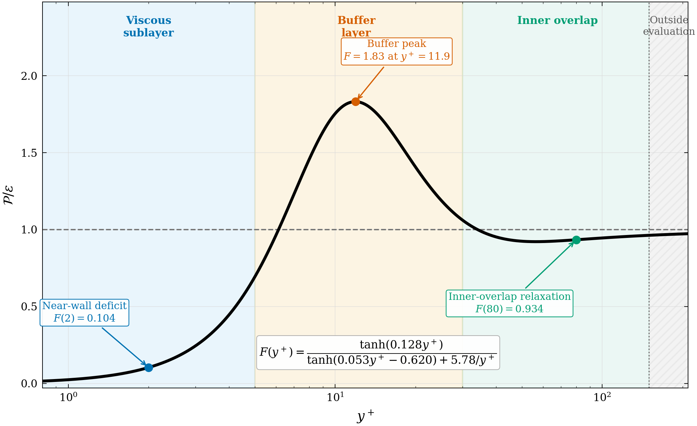
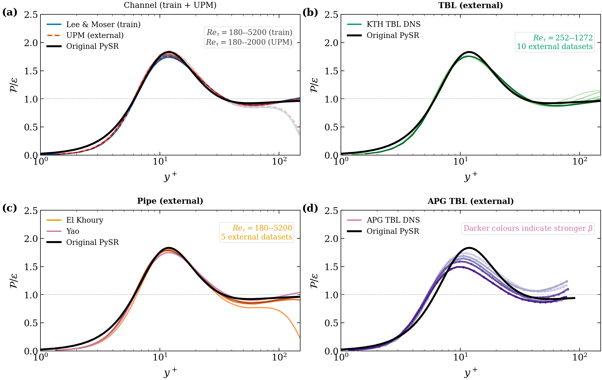

# Combining symbolic regression and turbulence physics to develop a compact inner-layer production–dissipation closure

Code and data records for the article of the above title by **Jianou Jiang** and
**Budimir Rosic** (Department of Engineering Science, University of Oxford), published in
*Physics of Fluids* (AIP Publishing) and selected by the Editors as a **Featured Article**.

> *Physics of Fluids* **38**, 095140 (2026) · [doi:10.1063/5.0347368](https://doi.org/10.1063/5.0347368) · published online 9 September 2026

News coverage: [University of Oxford, Department of Engineering Science](https://eng.ox.ac.uk/news/oxford-researchers-use-machine-learning-to-simplify-a-longstanding-turbulence-problem) (22 September 2026).

[](https://colab.research.google.com/github/JianouJiang/symbolic-regression-pe-closure/blob/v1.0.0/examples/five_minute_tutorial.ipynb)
[](https://doi.org/10.5281/zenodo.22806787)

## Try it in five minutes

Open the [executed tutorial notebook](examples/five_minute_tutorial.ipynb),
or use **Open in Colab** above and choose **Runtime → Run all**. The tutorial
compares the recommended closure, M16, and the equilibrium assumption with
one small Lee–Moser DNS profile. It downloads and verifies the original data
automatically; no model training or CFD simulation is needed.

From a local clone:

```bash
python3 -m pip install -r requirements.txt
python3 examples/quickstart.py
```

This reproduces the paper's nominal-550 channel dissipation diagnostic on
49 points. It is a training-family illustration using DNS production.
See the [tutorial guide](examples/README.md) for provenance, interpretation,
offline use, and output files.



*Figure 1 of the article: the near-wall turbulence problem addressed by the closure.*

## The closure

The recommended closure for the inner-layer production-to-dissipation ratio is

```
                 tanh(0.128 y+)
F_PySR(y+) = ---------------------------------
             tanh(0.053 y+ - 0.620) + 5.78/y+
```

on the domain `1 < y+ <= min(150, 0.3 Re_tau)` for incompressible, smooth-wall,
pressure-driven flows. A squared-numerator variant (the **M16** benchmark, coefficients
`0.111, 0.052, 0.443, 2.888`) enforces the exact kinematic cubic wall exponent and is
retained as a physics-constrained asymptotic benchmark. Known limitations are stated in
the article: accuracy deteriorates under strong adverse pressure gradients, and the closure
is not an outer-wake model. The article's statement that it fails on plane Couette flow is
corrected [below](#corrections-to-the-published-article): it also describes that flow.



*Figure 3 of the article, with panel (d) corrected (see [below](#corrections-to-the-published-article)):
the production–dissipation ratio collapses onto the same inner-layer curve across channel,
pipe and boundary-layer flows, and its peak falls as the adverse pressure gradient grows.*

Ready-to-use implementation:

```python
import numpy as np
from closure.pe_closure import f_pysr, f_m16, valid_domain

re_tau = 550
yplus = np.array([0.0, 5.0, 12.0, 30.0, 100.0, 200.0])
mask = valid_domain(yplus, re_tau)
F = f_pysr(yplus[mask])           # evaluate positive, in-domain coordinates
```

`python3 closure/pe_closure.py` prints a small reference table.

## Corrections to the published article

Three corrections to the published version were found after publication. They do not
change the closure, its coefficients or the recommendation to use the PySR expression,
and one of them widens the closure's demonstrated range. The scripts in
[`corrections/`](corrections/) reproduce both the published and the corrected numbers.

**1. Plane Couette flow.** The Couette budgets of Lee and Moser (2018) were read with the
wrong column: column 3 (turbulent transport) was used as the dissipation instead of
column 7. With the dissipation column, P/ε in plane Couette flow follows the channel curve
(peak 1.72–1.76 near y+ = 11), and the recommended expression gives R² = 0.992, 0.993 and
0.972 at Re_tau = 93, 220 and 500 without refitting (M16: 0.997, 0.993 and 0.981). The
closure therefore also describes plane Couette flow; it does not fail there
([`couette_check.py`](corrections/couette_check.py), which downloads the three budget files
from the provider).

**2. Range of the dissipation result.** The 88–95 % reduction in dissipation-prediction
RMSE holds over 5 < y+ < 80, as Sec. V B, Table VI and the Conclusion state; the abstract
and the introduction quote it without the range. Over the whole inner-layer domain the
reduction is 53–64 %, because below y+ = 5 the recommended expression approaches the wall
quadratically rather than cubically (40–47 % for 1 < y+ ≤ 5). M16, which keeps the cubic
wall behaviour, gives 87–96 % over the whole domain and is the better choice for the
dissipation below y+ = 5 ([`dissipation_by_region.py`](corrections/dissipation_by_region.py),
on the channel and pipe profiles of Table VI).

**3. Fig. 3(d).** The panel shows five zero-pressure-gradient boundary-layer profiles (a
subset of panel b) instead of the five adverse-pressure-gradient series of Bobke et al.
(2017): the plotting script fell back to those profiles when the adverse-pressure-gradient
files were missing. The results quoted for these series (Sec. IV C, Table V, Figs. 4c and
5a) were computed from the correct data and are unchanged. The figure above shows the
corrected panel: each curve is the station of largest β in its series (β = 1.12, 1.62,
2.19, 2.80 and 4.53), and the peak of P/ε falls from 1.74 to 1.49 as β grows. Panels (a)–(c)
and the caption are unchanged ([`apg_panel.py`](corrections/apg_panel.py); vector file
[`fig_pe_collapse_corrected.pdf`](corrections/fig_pe_collapse_corrected.pdf)).

What should change in the article:

| Where | Published | Corrected |
|---|---|---|
| Abstract | "…the closure is not an outer-wake model, and it fails out of domain on plane Couette flow." | "…the closure is not an outer-wake model; it also describes plane Couette flow (R² = 0.97–0.99)." |
| Abstract | "reduces inner-layer dissipation-prediction RMSE by 88–95%" | "reduces dissipation-prediction RMSE by 88–95% over 5 < y+ < 80" |
| Sec. I | "reduces dissipation-prediction root-mean-square error (RMSE) by 88–95% across both training and external geometries" | "… by 88–95% over 5 < y+ < 80 across both training and external geometries" |
| Sec. I | "(c) a marked out-of-domain failure on plane Couette flow; the available comparison does not by itself identify whether wall-motion driving or another omitted variable causes that failure" | "(c) transfer to plane Couette flow (R² = 0.97–0.99)" |
| Sec. I | "Accuracy deteriorates for strong APG, the formula fails out of domain on Couette flow, and no claim is made …" | "Accuracy deteriorates for strong APG, and no claim is made …" |
| Sec. II E | "Negative R² (as observed for Couette flow) indicates …" | "Negative R² indicates …" |
| Sec. IV C, item 2 | "Accuracy deteriorates as the APG becomes strong and the formula fails out of domain on Couette flow (R² < 0); neither result is repaired by an unvalidated correction here." | "Accuracy deteriorates as the APG becomes strong; this is not repaired by an unvalidated correction here." |
| Sec. IV C, Couette paragraph | "… P/ε is much larger than in channel or pipe flow. The formula returns R² < 0 at all three Reynolds numbers … This establishes lack of transfer to Couette flow, but …" | "… P/ε follows the channel curve, with a peak of 1.72–1.76 near y+ = 11. The formula gives R² = 0.992, 0.993 and 0.972 at Re_tau = 93, 220 and 500 without refitting (Table V)." |
| Table V, Couette row | mean R² "< 0" | mean R² 0.986 |
| Fig. 3(d) | five zero-pressure-gradient profiles | the five adverse-pressure-gradient series (figure above) |
| Sec. V C, item (v) | "Its failure on plane Couette flow is a solver-facing, out-of-domain limitation: …" | delete the sentence |
| Sec. VI, item 3 | "… and its Couette failure creates a solver-facing regime-handling requirement without identifying the cause of failure." | "…; it also describes plane Couette flow." |

Quotations follow the accepted manuscript; the typeset article may differ in punctuation.
The records under `replay/results/` reproduce the article as published, including its
Couette rows, which were computed from preprocessed archives built with the column error.

## Repository layout

- `closure/` — stand-alone NumPy implementation of the two printed formulas.
- `examples/` — executable five-minute tutorial and small DNS demonstration.
- `FORMULA_DECISION.md` — the formula-selection rule, its result, and the numerical
  basis (the exact paired comparison on the frozen manifest).
- `records/manifest/` — the frozen 179-row per-profile manifest with evaluation masks,
  source SHA-256 hashes and historical-exposure labels, the frozen wall-amplitude fit,
  and the full-suite evaluator that scores both formulas on identical points and masks.
- `records/audits/` — the paired formula-comparison loaders, the pressure-transport
  audit, and the wall-asymptote/attached-eddy contracts.
- `records/fitting/` — the matched-objective fitting method and its configuration.
- `replay/` — the replay driver and the four regenerated evidence records (paired
  formula comparison, matched-training diagnostic, pressure-transport audit,
  wall-asymptote/attached-eddy record).
- `audit/` — an independent clean-room recomputation of the printed-form decision, the
  direct channel/pipe dissipation diagnostic, and the pressure-transport sensitivity
  test.
- `corrections/` — scripts and records for the corrections to the published article.
- `supplementary/` — the STLSQ sparse-regression verification (script, results and
  figure), the bootstrap wall-exponent record, wall-weighted refit,
  adverse-pressure-gradient parsing and Pareto-ablation analyses, and the compact
  adverse-pressure-gradient budget records.
- `codes/analysis/` — figure-generation code for the article's validation figures.
- `figures/` — the two article figures shown above.
- `SHA256SUMS.txt` — checksums for the archived record files.

## Verify / replay

The compact records in this repository already contain every number quoted in the
article. To regenerate them from the underlying DNS/LES data, first stage the public
datasets (they are **not** redistributed here; each expected path and its SHA-256 digest
are recorded in `records/manifest/profile_manifest_freeze.json`, and the originating
research groups are credited and cited in the article):

- `codes/results/` — preprocessed profile archives (NumPy `.npz`) built from the public
  DNS/LES databases;
- `codes/data_processing/` — the downloaded budget tables and caches;
- `related_papers/` — the pipe-flow budget tables;
- `records/manifest/source_cache/` — the adverse-pressure-gradient source archive.

Then, with Python 3, NumPy and SciPy installed (see `requirements.txt`):

```bash
python3 replay/replay_evidence.py
python3 audit/recompute_clean_room_metrics.py
```

run from the repository root. The first command verifies every recorded source digest
and regenerates the four evidence records under `replay/results/`; the second
regenerates the clean-room audit. Regenerated files can be compared against
`SHA256SUMS.txt`.

## Citation

> J. Jiang and B. Rosic, "Combining symbolic regression and turbulence physics to develop
> a compact inner-layer production–dissipation closure," *Physics of Fluids* **38**,
> 095140 (2026). https://doi.org/10.1063/5.0347368

```bibtex
@article{Jiang2026PoF,
  author  = {Jiang, Jianou and Rosic, Budimir},
  title   = {Combining symbolic regression and turbulence physics to develop a compact
             inner-layer production--dissipation closure},
  journal = {Physics of Fluids},
  volume  = {38},
  number  = {9},
  pages   = {095140},
  year    = {2026},
  doi     = {10.1063/5.0347368},
  note    = {Featured Article}
}
```

## Licence

The code and record files in this repository are released under the MIT Licence (see
`LICENSE`). The DNS/LES databases referenced by the manifest are the property of their
original providers and are not covered by this licence.
